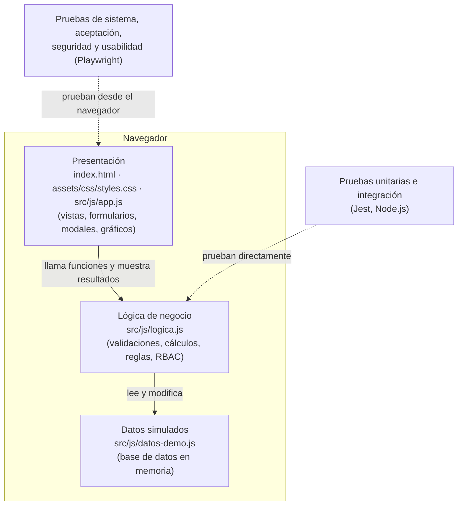
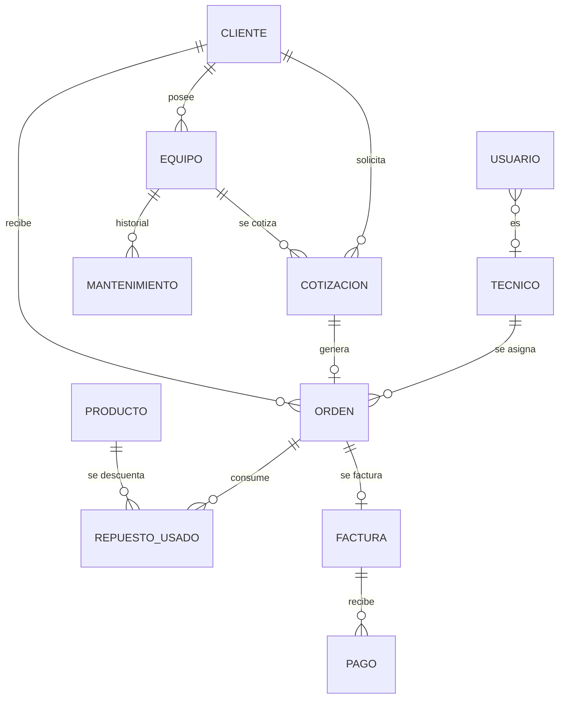

# 1. Documentación técnica — SIGEM

**Sistema Integral de Gestión Electromecánica**
Curso: Aseguramiento de la Calidad de Software · Universidad Mariano Gálvez de Guatemala · Campus Villa Nueva
Versión del documento: 1.1 · Octubre 2026

---

## 1.1 Descripción general

SIGEM es una plataforma web para administrar una empresa dedicada al soporte técnico de **bombas de agua, motores eléctricos, paneles de control y variadores de frecuencia**. Cubre el ciclo completo del negocio: desde el registro del cliente y su equipo, la cotización y la orden de trabajo, la ejecución del servicio en campo por parte del técnico, hasta la facturación, el cobro y el análisis de rentabilidad.

El entregable es un **prototipo funcional navegable** con datos simulados. No tiene backend ni base de datos real; la lógica de negocio está implementada y probada de forma independiente para que pueda migrarse a una API REST sin reescribirse.

## 1.2 Alcance

| Incluido | Fuera de alcance (simulado) |
|---|---|
| 14 módulos navegables con datos de ejemplo | Persistencia en base de datos (los datos viven en memoria) |
| Autenticación y control de acceso por rol | Autenticación en servidor, cifrado de contraseñas, JWT |
| Cálculos de cotización, facturación, pagos y rentabilidad | Facturación electrónica FEL / SAT |
| Validación de agenda de técnicos | Envío de correos o notificaciones reales |
| Reporte técnico imprimible (PDF desde el navegador) | Generación de PDF en servidor |
| Exportación de reportes a CSV | Integración con sistemas contables |

## 1.3 Metodología de desarrollo

Se trabajó con **Scrum**, con entregas incrementales por módulo. La estrategia de pruebas se describe en [02-plan-de-pruebas.md](02-plan-de-pruebas.md).

## 1.4 Arquitectura

La aplicación es una *Single Page Application* estática dividida en tres capas con responsabilidades separadas:



**Decisión de diseño:** `logica.js` no usa el DOM ni variables globales; todas sus funciones reciben la base de datos como parámetro y devuelven `{ ok, error, ... }`. Esto permite:

1. Probar las reglas de negocio de forma aislada (pruebas unitarias e integración).
2. Que la interfaz solo se encargue de leer formularios y mostrar resultados.
3. Reutilizar la misma lógica en un backend Node.js en una versión futura.

### Tecnologías

| Componente | Tecnología |
|---|---|
| Interfaz | HTML5, CSS3, JavaScript (ES2020), sin frameworks ni dependencias externas |
| Gráficos | Motor propio sobre `<canvas>` |
| Pruebas unitarias e integración | Jest 29 |
| Pruebas de sistema, aceptación, seguridad y usabilidad | Playwright (Chromium, escritorio y móvil) |
| Integración continua | GitHub Actions |
| Publicación | GitHub Pages |

### Evolución propuesta a producción

| Capa | Prototipo actual | Producción |
|---|---|---|
| Frontend | HTML/JS | React + Tailwind CSS |
| Lógica | `logica.js` en el navegador | API REST en Node.js/Express reutilizando `logica.js` |
| Datos | Memoria | PostgreSQL |
| Autenticación | Simulada | JWT + contraseñas con hash (bcrypt) |
| Facturación | Simulada | Certificador FEL autorizado por SAT |

## 1.5 Estructura del repositorio

```
sigem-aseguramiento/
├── index.html                  # Punto de entrada de la aplicación
├── assets/css/styles.css       # Estilos y diseño responsive
├── src/js/
│   ├── logica.js               # Reglas de negocio (módulo probado)
│   ├── datos-demo.js           # Datos simulados
│   └── app.js                  # Interfaz: vistas, formularios y navegación
├── tests/
│   ├── helpers/                # Contexto compartido de pruebas
│   ├── unit/                   # Pruebas unitarias (Jest)
│   ├── integration/            # Pruebas de integración (Jest)
│   └── e2e/                    # Sistema, aceptación, regresión, seguridad, usabilidad (Playwright)
├── docs/                       # Esta documentación
├── .github/
│   ├── workflows/pruebas.yml   # Integración continua
│   └── ISSUE_TEMPLATE/         # Plantilla para reportar defectos
├── playwright.config.js
└── package.json
```

## 1.6 Roles y permisos

| Módulo | Administrador | Administrativo | Técnico |
|---|:---:|:---:|:---:|
| Dashboard | ✅ completo | ✅ completo | ✅ solo sus indicadores |
| Clientes, Equipos, Cotizaciones, Órdenes | ✅ | ✅ | ❌ |
| Mi panel técnico | — | — | ✅ solo sus órdenes |
| Inventario | ✅ | ❌ | ❌ (registra repuestos usados desde su orden) |
| Facturación, Pagos y CxC | ✅ | ✅ | ❌ |
| Gastos, Rentabilidad, Reportes gerenciales | ✅ | ❌ | ❌ |
| Usuarios, roles y bitácora | ✅ | ❌ | ❌ |
| Guía de la demo | ✅ | ✅ | ✅ |

La matriz está definida en un solo lugar (`PERMISOS` en `logica.js`) y la usan tanto el menú como el enrutador, el buscador global y la apertura de órdenes individuales.

### Usuarios de prueba

| Rol | Correo | Contraseña |
|---|---|---|
| Administrador | admin@sigem.com | 123456 |
| Administrativo | administrativo@sigem.com | 123456 |
| Técnico (Carlos Méndez) | tecnico@sigem.com | 123456 |
| Técnico | jramirez@sigem.com / lherrera@sigem.com | 123456 |
| Administrativo **inactivo** | fruiz@sigem.com | 123456 (debe ser rechazado) |

## 1.7 Modelo de datos



| Entidad | Campos principales | Estados |
|---|---|---|
| Cliente | código, nombre, empresa, NIT, teléfono, correo, dirección | Activo, Inactivo |
| Equipo | código, cliente, tipo, marca, modelo, HP, voltaje, serie, ubicación, último mantenimiento | Activo, En mantenimiento, Fuera de servicio, Inactivo |
| Cotización | número, cliente, equipo, tipo de servicio, fecha, vigencia, técnico, líneas, descuento, impuesto | Borrador, Enviada, Aprobada, Rechazada, Vencida |
| Orden de trabajo | número, cotización, cliente, equipo, técnico, fecha, hora, prioridad, descripción, ejecución | Pendiente, Programada, En proceso, En espera, Finalizada, Cancelada |
| Producto | código, nombre, categoría, existencia, stock mínimo, costo, precio, proveedor | Stock normal / Stock bajo |
| Factura | número, cliente, orden, fecha, subtotal, impuesto, total | Pendiente, Parcial, Pagada, Vencida, Anulada |
| Pago | número, factura, cliente, fecha, método, monto | — |
| Gasto | fecha, categoría, descripción, proveedor, monto, impuesto | — |

## 1.8 Reglas de negocio

| ID | Regla |
|---|---|
| RN-01 | Total de cotización = (Σ cantidad × precio − descuento) + impuesto. El descuento se aplica antes del impuesto. Valores redondeados a 2 decimales. |
| RN-02 | Solo una cotización **Aprobada** habilita el botón "Generar orden de trabajo", y genera **una sola** orden. Una cotización con orden no puede editarse ni cambiar de estado. |
| RN-03 | Un técnico no puede tener dos órdenes activas (no canceladas) en la misma fecha y hora. |
| RN-04 | Una orden solo se finaliza desde el panel técnico; exige describir el trabajo realizado y que la hora de fin no sea anterior a la de inicio. |
| RN-05 | Al finalizar, los repuestos usados se descuentan del inventario. Si alguno no tiene existencia suficiente, la operación se rechaza completa (sin cambios parciales). |
| RN-06 | Un producto está en **stock bajo** cuando su existencia es menor o igual al stock mínimo. |
| RN-07 | Solo se factura una orden **Finalizada**, una vez (salvo que la factura previa se anule). La factura toma los montos de la cotización origen; si la orden no tiene cotización, se aplica la tarifa estándar (mano de obra Q800 + visita Q150 + repuestos usados a precio de venta) más IVA 12 %. |
| RN-08 | Un pago debe ser mayor que 0 y no mayor que el saldo. Si el saldo llega a 0 la factura pasa a **Pagada**; si no, a **Parcial**. |
| RN-09 | Una factura con saldo no puede marcarse Pagada manualmente; una factura Anulada no admite pagos ni cambios. |
| RN-10 | Rentabilidad = Ingreso **sin IVA** − (Mano de obra + Repuestos + Transporte + Otros). Margen = Utilidad ÷ Ingreso. El IVA no se considera ingreso porque se traslada a SAT. Costos internos: mano de obra 55 %, transporte 70 % y materiales 60 % del precio de venta; repuestos al costo de inventario. |
| RN-11 | NIT de cliente, serie de equipo y correo de usuario son únicos. |
| RN-12 | Solo usuarios **Activos** inician sesión. Un administrador no puede desactivarse ni quitarse el rol a sí mismo. Todo usuario con rol Técnico queda vinculado a un técnico de campo. |
| RN-13 | Toda operación relevante queda en la bitácora con fecha, usuario, acción y detalle. |

## 1.9 Consideraciones del prototipo

- **Datos en memoria:** recargar la página (F5) restablece los datos de ejemplo.
- **Fechas relativas:** los datos de ejemplo se ajustan a la fecha actual para que siempre existan órdenes "de hoy", próximas y vencidas.
- **Seguridad del lado del cliente:** el control de acceso se aplica en la interfaz y la lógica, pero al no haber servidor un usuario técnico con conocimientos podría manipular el código desde la consola del navegador. En producción, estas validaciones deben repetirse en la API.
